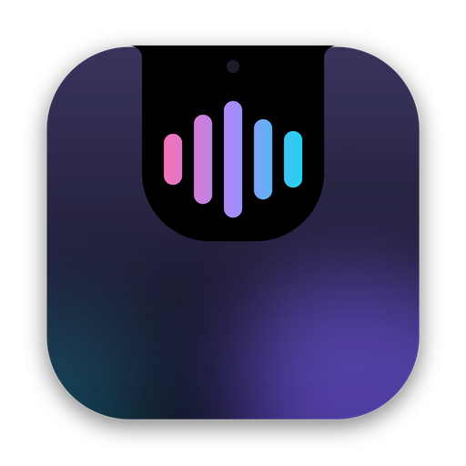
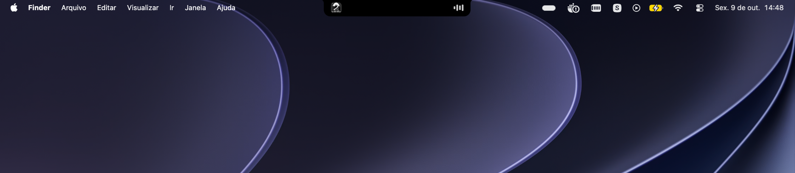
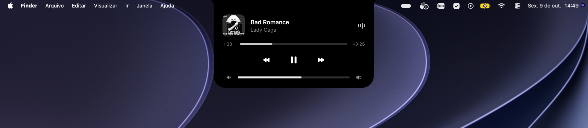

<p align="center"></p>

# Dynamic Lite

[](https://github.com/rafaelRizzo/dynamic-lite/releases/latest)


[](LICENSE)

Dynamic Island para macOS: uma forma "líquida" que vive no notch e vira player do Spotify.

> Inspirado no **Alcove**. Este é um projeto independente e open source, feito como uma alternativa livre. Não tem relação com o Alcove nem com seus criadores e não tem nenhuma intenção de prejudicá-los.

**Compacta**: tocando, capa à esquerda e equalizer à direita do notch.



**Aberta**: mouse em cima, com progresso, controles e volume.



## Instalar

1. Baixe o `.dmg` mais recente em [Releases](https://github.com/rafaelRizzo/dynamic-lite/releases/latest). É universal (Apple Silicon e Intel), macOS 12 ou mais novo.
2. Abra o `.dmg` e arraste **Dynamic Lite** pra **Aplicativos**.
3. O app não é assinado pela Apple. Na primeira vez, rode no Terminal:
   ```bash
   xattr -cr "/Applications/Dynamic Lite.app"
   ```
   Ou tente abrir uma vez, vá em Ajustes do Sistema → Privacidade e Segurança e clique **Abrir Mesmo Assim** no aviso do Dynamic Lite.
4. Abra o app e aceite o pedido de **Automação → Spotify**.
5. Ao dar play, aceite o pedido de **gravação de áudio do sistema** (macOS 14.2+): o equalizer passa a seguir a música. Negando, ele só anima em loop.

Precisa do Spotify desktop instalado.

## Permissões

O macOS pergunta cada uma na hora em que o recurso é usado. Só a de Automação é necessária pra música; as outras liberam recursos opcionais, e negar uma só desliga o recurso dela.

| Permissão | Pra quê | Obrigatória | Onde ajustar |
|---|---|---|---|
| Automação → Spotify | Ler e controlar a música tocando | Sim | Privacidade e Segurança → Automação |
| Gravação de áudio do sistema (macOS 14.2+) | Equalizer seguir a música; negando, ele anima em loop | Não | Privacidade e Segurança → Gravação de Tela e Áudio do Sistema |
| Calendários | Aba da agenda e aviso antes dos eventos | Não | Privacidade e Segurança → Calendários |
| Acessibilidade | Com a Island aberta, o gesto de 3 dedos só troca de aba, sem trocar de mesa nem abrir o Mission Control; negando, o sistema reage ao gesto junto | Não | Privacidade e Segurança → Acessibilidade |
| Keychain | Ler o token do Claude Code pra consultar o limite do plano; negando, o app lê o arquivo do statusline | Não | Diálogo do Keychain (**Sempre Permitir** evita perguntar de novo) |

Também usa a internet: GitHub (atualizações) e `api.anthropic.com` (limite do Claude Code, desligável nos Ajustes). O app é assinado com um certificado próprio, não pela Apple, então as permissões sobrevivem às atualizações (ver [Assinatura](#assinatura)). Na primeira atualização depois dessa mudança o macOS ainda pede tudo uma última vez.

## Usar

| Estado | Quando | Mostra |
|---|---|---|
| Parada | nada tocando | só o notch, invisível |
| Compacta | Spotify tocando | capa à esquerda, equalizer à direita |
| Compacta | outro app tocando (opção **Seguir o áudio do sistema**, Spotify parado) | nota musical à esquerda, equalizer à direita |
| Aberta | mouse sobre a Island | capa, faixa, progresso, controles, aleatório, repetir e volume |

- **Clique na capa** (aberta): abre a faixa no Spotify.
- **Volume**: o botão ao lado do tempo abre um painel com mute.
- **Repetir**: um clique repete a playlist, outro repete só a faixa.
- **Pausado**: a Island volta ao tamanho do notch, mas abre no hover pra dar play.
- **Mac sem notch**: simula um notch no topo central da tela (ou some sem música, configurável).
- **Clique direito na Island** ou no ícone da menu bar: **Ajustes…** e **Sair**. Não tem ícone no Dock.
- Roda uma instância só: abrir o app de novo traz os Ajustes.

## Ajustes

Clique direito na Island → **Ajustes…**. Tudo vale na hora, sem reiniciar.

| Grupo | Ajuste | Opções |
|---|---|---|
| Aparência | Estilo do painel aberto | Preto, Translúcido (opacidade 60-100%), Vidro (Liquid Glass, macOS 26+), Capa |
| | Cor de destaque | Da capa, Branca |
| | Estilo do equalizer | Barras, ou um GIF seu (até 50 MB, tamanho 16-32 px, limitado à altura da Island). O GIF roda igual tocando ou pausado e fica em `equalizer.gif` na pasta de configuração |
| Áudio | Seguir o áudio do sistema | Desligado por padrão. Com o Spotify parado, qualquer app tocando (YouTube, Apple Music...) mostra equalizer e uma aba "Áudio"; em navegador (Chrome, Edge, Brave, Arc, Safari...) lê o título da aba de YouTube e afins, com miniatura no YouTube (pede Automação do navegador). Mantém o indicador de gravação de áudio enquanto algum app tiver áudio aberto |
| Comportamento | Abrir com | Passar o mouse (com atraso ajustável), Clique |
| | Toque no trackpad | Clique leve sentido no dedo ao abrir e fechar |
| Tela | Mostrar em | Automática (tela com notch), Principal, ou uma tela pelo nome |
| | Mesas | Todas, ou só a atual |
| | Esconder no Mission Control | Não cobre a barra de mesas no topo |
| | Esconder sem música | Só em telas sem notch |
| Atualizações | Verificar automaticamente | Ao abrir e uma vez por dia; botão "Verificar agora" |
| Sistema | Iniciar com o macOS | |
| | Ícone na menu bar | Sem ele, o acesso é pelo clique direito |

Sobre os estilos:

- A Island compacta é preta, pra fundir com o notch (exceto no estilo Capa).
- **Vidro**: o painel aberto vira Liquid Glass saindo do notch. Em macOS sem suporte, cai pro Translúcido.
- **Capa**: a Island compacta e o painel aberto ficam na cor da capa da música, com texto e controles claros ou escuros conforme o contraste.

Os ajustes ficam em `~/Library/Application Support/com.rafael.dynamic-lite/settings.json`. Pra voltar ao padrão, apague o arquivo e reabra o app.

## Atualizações

O app procura versão nova ao abrir, uma vez por dia e sempre que você abre os Ajustes. Quando encontra:

- Os Ajustes mostram **Atualizar pra X.Y.Z** no topo.
- O clique direito e o menu da menu bar ganham **Instalar atualização e reabrir**.
- Sem música tocando, a Island mostra um aviso com **Depois** e **Instalar e reabrir**.

A instalação baixa, substitui o app e reabre sozinha.

## Desempenho

Medido num Mac Apple Silicon, macOS 26, build de release, Spotify tocando com a Island compacta e o equalizer animado (o pior caso: parado, a Island fica invisível).

| Métrica | Valor |
|---|---|
| Download (`.dmg` universal) | ~7,4 MB |
| Em disco (`.app`) | ~17 MB |
| Memória | ~155 MB no total: ~54 MB do app + ~120 MB dos processos do WebKit do macOS (WebContent, GPU, Rede) |
| CPU | ~3% de um núcleo em média, somando app e WebKit (parado, com a Island invisível: ~0,5%) |

A memória e a CPU incluem os processos do WebKit porque o Tauri usa a webview do sistema em vez de embutir um Chromium. Por isso o app é leve em disco, mas a UI roda em processos separados.

O equalizer é um único `<canvas>` desenhado por JS a 20 quadros por segundo. Barras animadas por CSS, cada uma numa camada própria da webview, custavam ~4x mais CPU (~12%).

## Gerar o app você mesmo

Requisitos:

- [Xcode Command Line Tools](https://developer.apple.com/xcode/resources/): `xcode-select --install`
- [Rust](https://rustup.rs): `curl --proto '=https' --tlsv1.2 -sSf https://sh.rustup.rs | sh`
- [Bun](https://bun.sh): `curl -fsSL https://bun.sh/install | bash`

Build:

```bash
git clone https://github.com/rafaelRizzo/dynamic-lite.git
cd dynamic-lite
bun install
bun run tauri build
```

| Arquivo | Caminho |
|---|---|
| App | `src-tauri/target/release/bundle/macos/Dynamic Lite.app` |
| Instalador | `src-tauri/target/release/bundle/dmg/Dynamic Lite_<versão>_<arch>.dmg` |

Instale abrindo o `.dmg` ou copiando o app direto:

```bash
cp -R "src-tauri/target/release/bundle/macos/Dynamic Lite.app" /Applications/
open "/Applications/Dynamic Lite.app"
```

O build sai pra arquitetura do seu Mac. Pra gerar um universal (Apple Silicon + Intel):

```bash
rustup target add x86_64-apple-darwin aarch64-apple-darwin
bun run tauri build --target universal-apple-darwin
```

Sai em `src-tauri/target/universal-apple-darwin/release/bundle/`. Precisa do Rust instalado pelo rustup; o do Homebrew só tem a arquitetura da máquina.

## Assinatura

O macOS amarra cada permissão à identidade de assinatura do app. Com assinatura ad-hoc (`signingIdentity: "-"`) essa identidade é o hash do binário, que muda a cada build, e toda atualização pedia tudo de novo. A release usa um certificado autoassinado fixo (`Dynamic Lite Signing`): a identidade vira bundle id + certificado, igual em todo build. Não é Developer ID e não há notarização, então o `xattr -cr` da instalação continua necessário.

Pra assinar a release no seu fork (uma vez):

```bash
D=~/.dynamic-lite-signing && mkdir -p $D && cd $D
printf '[req]\ndistinguished_name=dn\nx509_extensions=v3\nprompt=no\n[dn]\nCN=Dynamic Lite Signing\n[v3]\nbasicConstraints=critical,CA:false\nkeyUsage=critical,digitalSignature\nextendedKeyUsage=critical,codeSigning\n' > openssl.cnf
/usr/bin/openssl req -x509 -newkey rsa:2048 -nodes -keyout key.pem -out cert.pem -days 3650 -config openssl.cnf
/usr/bin/openssl rand -base64 24 | tr -d '\n' > password.txt
/usr/bin/openssl pkcs12 -export -inkey key.pem -in cert.pem -out signing.p12 -passout file:password.txt
base64 -i signing.p12 | gh secret set SIGNING_CERT_P12 --env release
gh secret set SIGNING_CERT_PASSWORD --env release < password.txt
```

Guarde o `.p12` e a senha em lugar seguro: com outro certificado a identidade muda, e as permissões são pedidas de novo uma vez. Use o `/usr/bin/openssl` (LibreSSL); o OpenSSL 3 gera um `.p12` que o `security import` do macOS não lê.

## Problemas comuns

| Sintoma | Solução |
|---|---|
| Island não mostra a música | Ajustes do Sistema → Privacidade e Segurança → Automação → Dynamic Lite → ative **Spotify** |
| Negou a permissão sem querer | `tccutil reset AppleEvents com.rafael.dynamic-lite` e abra o app de novo |
| Gesto de 3 dedos ainda troca de mesa | Ajustes do Sistema → Privacidade e Segurança → Acessibilidade → ative **Dynamic Lite** (ou `tccutil reset Accessibility com.rafael.dynamic-lite`) |
| Agenda sem eventos | Ajustes do Sistema → Privacidade e Segurança → Calendários → ative **Dynamic Lite** |
| Equalizer não segue a música | Ajustes do Sistema → Privacidade e Segurança → Gravação de Tela e Áudio do Sistema → ative **Dynamic Lite** (ou `tccutil reset AudioCapture com.rafael.dynamic-lite`) |
| "não pode ser aberto" / "está danificado" | `xattr -cr "/Applications/Dynamic Lite.app"` |
| "não é compatível com este Mac" | Mac Intel com build só Apple Silicon: baixe o `.dmg` das Releases ou gere o universal |
| Island na tela errada | Ajustes → Tela → **Mostrar em** |
| Island cobrindo a barra de mesas | Ajustes → Tela → **Esconder no Mission Control** |

## Limitações

- Só Spotify. Outros players exigiriam uma API do sistema bloqueada pra apps de terceiros desde o macOS 15.4.
- Não dá pra curtir faixas: o Spotify não expõe isso pro app.
- Na Island compacta, ela pode cobrir itens da menu bar colados no notch.

## Licença

[MIT](LICENSE). Pode usar, modificar e distribuir, inclusive comercialmente, mantendo o aviso de copyright.
